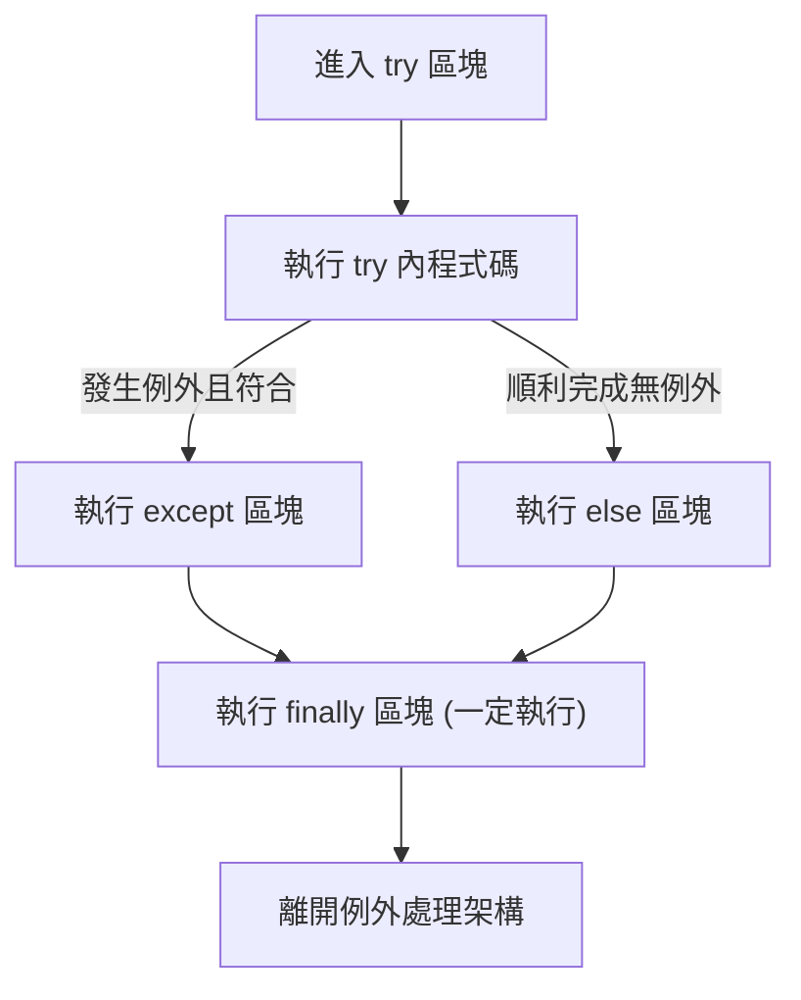

# Python 例外處理教學手冊：從入門到精通 (Exception Handling)

本教學手冊專為 Python 初學者與進階學習者設計，以「由淺入深」、「循序漸進」的方式介紹 Python 的例外處理機制。手冊中包含豐富的程式碼範例、執行結果、架構分析與常見陷阱，適合課堂教學與自學指引。

---

## 目錄
1. [什麼是例外？為什麼需要例外處理？](#1-什麼是例外為什麼需要例外處理)
2. [基礎語法：`try ... except`](#2-基礎語法try--except)
3. [進階捕捉：指定例外類型與捕捉多個例外](#3-進階捕捉指定例外類型與捕捉多個例外)
4. [完整結構：`try ... except ... else ... finally`](#4-完整結構try--except--else--finally)
5. [主動觸發例外：`raise`](#5-主動觸發例外raise)
6. [物件導向進階：自訂例外類別 (Custom Exceptions)](#6-物件導向進階自訂例外類別-custom-exceptions)
7. [現代 Python 最佳實踐與實戰技巧](#7-現代-python-最佳實踐與實戰技巧)
8. [常見例外速查表與課堂練習題](#8-常見例外速查表與課堂練習題)

---

## 1. 什麼是例外？為什麼需要例外處理？

### 1.1 語法錯誤 (SyntaxError) vs. 執行時期例外 (Exception)
在 Python 中，錯誤大致分為兩類：
1. **語法錯誤 (Syntax Error)**：程式碼寫錯（例如少括號、縮排錯誤）。Python 在**編譯/解析階段**就會直接報錯，程式根本無法開始執行。
2. **例外 (Exception)**：語法完全正確，但在**執行時期 (Runtime)** 遇到了無法繼續正常運行的狀況（例如除以零、檔案找不到、存取不存在的字典鍵）。

```python
# 語法錯誤範例（解析階段失敗）
# print("Hello"  # 缺少右括號 -> SyntaxError

# 執行時期例外範例（執行到這行才出錯）
result = 10 / 0  # 語法合法，但數學上無法除以零 -> ZeroDivisionError
```

### 1.2 為什麼不能放任程式崩潰？
當程式發生例外且未經處理時，Python 會印出「回溯追蹤訊息 (Traceback)」並**立刻終止程式**。
在實際應用中（例如伺服器、圖形介面或批次資料處理）：
- 我們不希望因為一筆壞資料導致整個伺服器掛掉。
- 我們希望給使用者友善的提示，而不是一長串嚇人的錯誤訊息。
- 我們需要在出錯時妥善關閉資源（如儲存檔案、關閉資料庫連線）。

---

## 2. 基礎語法：`try ... except`

例外處理最基本的骨幹就是 `try` 與 `except`。

### 語法結構
```python
try:
    # 可能會發生例外的程式碼
    ...
except:
    # 發生例外時要執行的應對處理
    ...
```

### 範例 2.1：處理除以零錯誤
```python
def divide(a, b):
    try:
        result = a / b
        print(f"{a} / {b} = {result}")
    except:
        print("【錯誤】除數不能為 0！")

# 測試
divide(10, 2)  # 正常執行
divide(10, 0)  # 觸發例外，被 except 攔截
print("程式繼續正常執行...")
```

#### 執行結果
```text
10 / 2 = 5.0
【錯誤】除數不能為 0！
程式繼續正常執行...
```

> **重點觀念**：
> 當 `a / b` 發生錯誤時，`try` 區塊中後續的程式碼會被跳過，控制權立即轉移到 `except` 區塊。程式不會直接中斷，因此最後的 `print("程式繼續正常執行...")` 仍會被印出。

---

## 3. 進階捕捉：指定例外類型與捕捉多個例外

在實務上，**強烈反對使用裸 `except:`**，因為它會盲目攔截所有錯誤（甚至包含使用者按下 `Ctrl + C` 的中斷訊號）。我們應該清楚指出「想攔截什麼錯誤」。

### 3.1 指定特定例外類型
```python
def parse_age(text):
    try:
        age = int(text)
        print(f"年齡設定成功：{age} 歲")
    except ValueError:
        print(f"【格式錯誤】'{text}' 無法轉換為整數！")

parse_age("18")    # 成功
parse_age("abc")   # 觸發 ValueError
```

### 3.2 捕捉多個獨立的例外（分門別類處理）
一個程式區塊可能因為不同原因出錯，我們可以有多個 `except` 區塊：

```python
def calculate_average(scores, index):
    try:
        total = sum(scores)
        avg = total / len(scores)
        target = scores[index]
        print(f"第 {index} 位學生的成績為 {target}，平均分為 {avg}")
    except ZeroDivisionError:
        print("【錯誤】成績清單不可為空！")
    except IndexError:
        print(f"【錯誤】找不到索引值 {index} 的學生資料！")
    except TypeError:
        print("【錯誤】成績清單內包含非數值資料！")

# 測試各種情境
calculate_average([], 0)            # 觸發 ZeroDivisionError
calculate_average([80, 90], 5)       # 觸發 IndexError
calculate_average([80, "一百"], 0)   # 觸發 TypeError
calculate_average([80, 90, 100], 1)  # 正常運作
```

### 3.3 同時捕捉多種例外並取得錯誤訊息 (`as e`)
如果多種例外的處理邏輯相同，可以用括號元組包起來；透過 `as e` 可以將例外物件指派給變數，檢視系統詳細錯誤資訊。

```python
def open_and_read(filename):
    try:
        with open(filename, "r", encoding="utf-8") as f:
            content = f.read()
            num = int(content.strip())
            print(f"檔案數值為：{num}")
    except (FileNotFoundError, PermissionError) as e:
        print(f"【檔案系統錯誤】無法開啟檔案：{e}")
    except ValueError as e:
        print(f"【資料解析錯誤】內容不是有效數字：{e}")
    except Exception as e:
        # 捕捉其他非預期的 Exception，並印出其類別名稱與訊息
        print(f"【非預期錯誤 ({type(e).__name__})】：{e}")
```

---

## 4. 完整結構：`try ... except ... else ... finally`

Python 的例外處理機制非常完整，支援四個關鍵字搭配使用：



### 各區塊職責說明
- **`try`**：放「可能會出錯」的程式碼。
- **`except`**：只有在「出錯時」才會執行（負責補救、記錄錯誤）。
- **`else`**：只有在「**完全沒有出錯**」時才會執行（放主要業務邏輯，將正常流程與監控程式碼分開）。
- **`finally`**：**無論成功或失敗都保證會執行**（專門做資源清理、釋放連線、關閉檔案）。

### 範例 4.1：四者合一經典範例
```python
def safe_divide(a, b):
    print(f"\n--- 開始計算 {a} / {b} ---")
    try:
        val1 = float(a)
        val2 = float(b)
        result = val1 / val2
    except ValueError:
        print("【except】輸入值無法轉換為浮點數！")
    except ZeroDivisionError:
        print("【except】數學錯誤：除數不可為 0！")
    else:
        # 只有在完全無錯誤時才印出結果
        print(f"【else】計算成功！結果為：{result:.2f}")
    finally:
        # 無論是否發生例外，一定會執行此處
        print("【finally】計算流程結束，清理暫存狀態。")

# 測試三種狀況
safe_divide(10, 2)    # 成功 -> 走 try -> else -> finally
safe_divide(10, 0)    # 除以零 -> 走 try -> except -> finally
safe_divide("abc", 5) # 轉型失敗 -> 走 try -> except -> finally
```

#### 執行結果
```text
--- 開始計算 10 / 2 ---
【else】計算成功！結果為：5.00
【finally】計算流程結束，清理暫存狀態。

--- 開始計算 10 / 0 ---
【except】數學錯誤：除數不可為 0！
【finally】計算流程結束，清理暫存狀態。

--- 開始計算 abc / 5 ---
【except】輸入值無法轉換為浮點數！
【finally】計算流程結束，清理暫存狀態。
```

---

## 5. 主動觸發例外：`raise`

有時候程式本身語法正確，但「商業邏輯」不允許（例如：銀行提款金額為負數、年齡超過 200 歲）。此時我們可以用 `raise` 主動拋出例外。

### 5.1 主動拋出內建例外
```python
def register_user(username, age):
    if not username:
        raise ValueError("使用者名稱不能為空字串！")
    if age < 0 or age > 150:
        raise ValueError(f"無效的年齡：{age}，年齡必須介於 0 到 150 之間！")
    
    print(f"使用者 {username} ({age} 歲) 註冊成功！")

# 測試主動拋出
try:
    register_user("小明", -5)
except ValueError as err:
    print(f"註冊失敗原因：{err}")
```

### 5.2 重新拋出例外 (Re-raise)
在 `except` 內部捕捉例外後，做完日誌記錄或清理工作，再使用無參數的 `raise` 將例外繼續向上拋給呼叫者處理：

```python
def process_data(data):
    try:
        return 100 / data
    except ZeroDivisionError:
        print("【Log 記錄】偵測到除以零事件，正在記錄至系統日誌...")
        raise  # 重新拋出目前的例外，讓外層呼叫者知曉

try:
    process_data(0)
except ZeroDivisionError:
    print("【外層防護】最外層接收到了錯誤，跳出警示視窗通知使用者。")
```

---

## 6. 物件導向進階：自訂例外類別 (Custom Exceptions)

內建例外（如 `ValueError`、`KeyError`）有時過於抽象，無法清楚表達特定應用系統的業務錯誤。Python 允許我們繼承 `Exception` 類別來建立自訂例外。

### 6.1 基本自訂例外
```python
# 繼承自 Exception
class BankingError(Exception):
    """銀行系統基礎例外類別"""
    pass

class InsufficientFundsError(BankingError):
    """提款金額超過帳戶餘額時拋出"""
    def __init__(self, balance, amount):
        super().__init__(f"餘額不足！目前餘額：NT${balance}，嘗試提款：NT${amount}")
        self.balance = balance
        self.amount = amount
```

### 6.2 實際應用情境：銀行帳戶提款
```python
class BankAccount:
    def __init__(self, owner, balance=0):
        self.owner = owner
        self.balance = balance

    def withdraw(self, amount):
        if amount <= 0:
            raise ValueError("提款金額必須大於 0！")
        if amount > self.balance:
            raise InsufficientFundsError(self.balance, amount)
        
        self.balance -= amount
        print(f"【提款成功】已提領 NT${amount}，剩餘餘額：NT${self.balance}")

# 測試自訂例外
account = BankAccount("Alice", balance=1000)

try:
    account.withdraw(300)   # 成功
    account.withdraw(1500)  # 餘額不足，拋出 InsufficientFundsError
except InsufficientFundsError as e:
    print(f"【交易中止】：{e}")
    print(f"缺口金額：NT${e.amount - e.balance}")
except ValueError as e:
    print(f"【輸入無效】：{e}")
```

#### 執行結果
```text
【提款成功】已提領 NT$300，剩餘餘額：NT$700
【交易中止】：餘額不足！目前餘額：NT$700，嘗試提款：NT$1500
缺口金額：NT$800
```

---

## 7. 現代 Python 最佳實踐與實戰技巧

### 7.1 例外鏈 (Exception Chaining)：`raise ... from ...`
當你在捕捉某個底層例外後，想要轉包裝成高階例外時，使用 `from` 可以完整保留原始例外的 Traceback，除錯時一目瞭然。

```python
class DatabaseConnectionError(Exception):
    pass

def load_config_and_connect():
    try:
        # 假設讀取某個連線字串發生 IOError
        with open("db_config.json", "r") as f:
            _ = f.read()
    except FileNotFoundError as original_err:
        # 將底層的 FileNotFoundError 包裝成業務層級的 DatabaseConnectionError
        raise DatabaseConnectionError("資料庫設定載入失敗，無法連線！") from original_err
```

### 7.2 EAFP vs. LBYL 風格
在程式設計哲學中，Python 偏好 **EAFP**（Easier to Ask for Forgiveness than Permission，先做再說，出錯再道歉），而非傳統的 **LBYL**（Look Before You Leap，三思而後行）。

```python
data = {"name": "Bob", "role": "admin"}

# --- LBYL 風格（很多 if-else 檢查） ---
if "age" in data:
    age = data["age"]
else:
    age = 20

# --- EAFP 風格（Pythonic，使用 try-except） ---
try:
    age = data["age"]
except KeyError:
    age = 20
```

### 7.3 避免常見的反模式 (Anti-Patterns)
1. **永遠不要忽略例外 (Silent Failure)**：
   ```python
   # 糟糕的做法：發生錯誤卻完全不處理也不記錄，會讓 Bug 極難追蹤！
   try:
       do_something()
   except Exception:
       pass
   ```
2. **不要在 `finally` 中使用 `return`**：
   在 `finally` 區塊寫 `return` 會吃掉 `try` 或 `except` 中拋出的例外，導致錯誤消失。
3. **縮小 `try` 的範圍**：
   只把真正可能出錯的關鍵幾行放進 `try`，不要把幾百行程式碼全部塞進同一個大 `try` 區塊，否則很難定位到底哪一行壞掉。

---

## 8. 常見例外速查表與課堂練習題

### 8.1 內建常見例外對照表

| 例外名稱 | 常見觸發原因 | 程式碼範例 |
| :--- | :--- | :--- |
| **`ZeroDivisionError`** | 數字除以 0 | `10 / 0` |
| **`ValueError`** | 傳入型態正確但內容不合法的數值 | `int("abc")` |
| **`TypeError`** | 操作或函式套用了不相容的資料型別 | `"text" + 5` |
| **`IndexError`** | 存取序列（列表、元組）中超出範圍的索引 | `[1, 2][5]` |
| **`KeyError`** | 存取字典中不存在的鍵 | `{"a": 1}["b"]` |
| **`FileNotFoundError`** | 嘗試讀取不存在的檔案路徑 | `open("not_found.txt")` |
| **`AttributeError`** | 呼叫物件不存在的屬性或方法 | `"hello".non_exist()` |
| **`KeyboardInterrupt`** | 使用者按下 `Ctrl + C` 強制中斷 | 終端機按鍵中斷 |

---

### 8.2 學生課堂練習題

#### 練習 1：安全的整數輸入函式 (Safe Integer Input)
- **題目要求**：
  撰寫一個名為 `prompt_integer(prompt_text)` 的函式，反覆提示使用者在終端機輸入整數。
  若使用者輸入文字而非整數，捕捉 `ValueError` 並顯示提示：「輸入無效，請輸入純數字！」，直到使用者輸入正確整數為止，最後回傳該整數。
- **參考解答**：
```python
def prompt_integer(prompt_text):
    while True:
        user_input = input(prompt_text)
        try:
            val = int(user_input)
            return val
        except ValueError:
            print("【輸入無效】請輸入有效的整數！\n")

# 測試（可在互動式終端機執行）
# age = prompt_integer("請輸入您的年齡：")
# print(f"您輸入的年齡為：{age}")
```

#### 練習 2：安全字典取值器
- **題目要求**：
  撰寫一個函式 `safe_lookup(dictionary, key, default=None)`。
  嘗試從 `dictionary` 取得鍵為 `key` 的值，若發生 `KeyError` 則捕捉並回傳預設值 `default`，同時印出警告 log。
- **參考解答**：
```python
def safe_lookup(dictionary, key, default=None):
    try:
        return dictionary[key]
    except KeyError:
        print(f"[Warn] 找不到鍵值 '{key}'，使用預設值：{default}")
        return default

user_profile = {"name": "Charlie", "city": "Taipei"}
print(safe_lookup(user_profile, "name"))        # 輸出: Charlie
print(safe_lookup(user_profile, "email", "無")) # 輸出: 無
```
