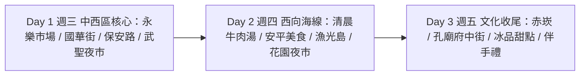

# 台南三天兩夜美食之旅完全攻略（平日版）

> **適用設定**：平日出發（推薦 **週三～週五**，兼顧老店公休錯開與夜市體驗）｜**台鐵／高鐵＋租機車或步行**｜**不忌口，同時附免大排長龍在地替代方案**

---

## 目錄
1. [行前總覽與動線規劃](#行前總覽與動線規劃)
2. [平日關鍵工具：公休日與夜市對照表](#平日關鍵工具公休日與夜市對照表)
3. [Day 1（建議週三）｜中西區經典小吃爆擊 × 武聖夜市](#day-1建議週三中西區經典小吃爆擊--武聖夜市)
4. [Day 2（建議週四）｜清晨六千牛肉湯 × 安平海風老街 × 花園夜市](#day-2建議週四清晨六千牛肉湯--安平海風老街--花園夜市)
5. [Day 3（建議週五）｜傳統早點 × 赤崁孔廟文化散步 × 伴手禮賦歸](#day-3建議週五傳統早點--赤崁孔廟文化散步--伴手禮賦歸)
6. [免排隊在地替代名單 & 預算參考](#免排隊在地替代名單--預算參考)

---

## 行前總覽與動線規劃

台南市區巷弄密集且單行道多，**平日「台鐵或高鐵轉沙崙線至台南火車站＋站前租機車」** 是機動性最高、最省停車費的組合。三天採「分區聚落」方式推進，同一天的點位騎車皆在 10～15 分鐘內：

### 住宿區域建議
- **首選｜中西區（海安路、友愛街、西門圓環周邊）**：下樓就是小吃一級戰區，晚上吃宵夜、小酌散步就能回飯店，不用酒後騎車。
- **次選｜台南火車站前站／成功路一帶**：租還機車與寄放行李最方便，適合最後一天要搭車趕高鐵的行程。

### 台南吃貨 4 大心法
1. **每攤點 1 份分食**：兩人以上同行強烈建議共食，才能從早吃到宵夜塞下 6～8 攤。
2. **善用「平日優勢」**：平日許多名店免排 1 小時，但要注意「**週二、週三、週四**」各有老店輪流公休，出發前務必對照下方公休表。
3. **自備環保餐具與小零錢**：市場攤位多只收現金（百元鈔與銅板最好用），且備好濕紙巾與保冷袋（買布丁／滷味超實用）。
4. **出發前滑一眼官方粉專**：台南老店偶有備料提早賣完或臨時休假，建議出門前快速確認 Google Maps 或店家 FB／IG 最新公告。

---

## 平日關鍵工具：公休日與夜市對照表

### 1. 台南三大夜市營業時間（「大大武花大武花」）

| 星期 | 營業夜市 | 平日逛街重點 |
| :---: | :--- | :--- |
| **星期一** | 大東夜市 / 大東東夜市 | 週一限定選項，人潮相對輕鬆 |
| **星期二** | 大東夜市 / 大東東夜市（另有小北成功夜市） | 東區聚餐完順路續攤首選 |
| **星期三** | **武聖夜市** | **老牌在地夜市，腹地大、好停機車** |
| **星期四** | **花園夜市** | **平日版花園夜市！不用人擠人就能吃遍大攤位** |
| **星期五** | 花園、大東/大東東、武聖 | 三大夜市齊開，週五夜晚選擇最豐富 |

### 2. 重點名店平日公休速查（避免撲空）

| 店家名稱 | 所在區域 | 公休日 | 營業提醒 |
| :--- | :--- | :--- | :--- |
| **金得春捲** | 永樂市場 | **星期二** | 與富盛號、阿松割包相鄰 |
| **矮仔成蝦仁飯** | 海安路／西門 | **星期二** | 08:30～19:30 |
| **阿憨鹹粥** | 北區公園南路 | **星期三** | 06:10～14:00 |
| **莉莉水果店** | 中西區府前路 | **星期三** | 11:00～22:00（孔廟旁） |
| **富盛號碗粿** | 永樂市場 | **星期四** | 民族路三段另有冷氣二店 |
| **阿松割包** | 永樂市場 | **星期四** | 主打豬舌包，常有不定期特休 |
| **文章牛肉湯** | 安平區 | **星期四** | **2026/09 已遷至安平路 592 號**（舊址整修中）；另有東寧旗艦店 |
| **六千泓佐土產牛肉** | 海安路一段 | **星期一、二、三** | 05:00 開賣，約 07:30～08:30 售完 |
| **邱家小卷米粉** | 國華街三段 | **星期一**（偶含週三） | 已遷至國華街三段 251 號（有冷氣） |
| **連得堂餅家** | 北區崇安街 | **星期日** | 平日 08:00～20:00，現場每人通常限購 2 包 |
| **阿明豬心冬粉** | 保安路 | **不定休（暫停營業中）** | 近期因家務暫停營業中，重開日未定，出發前務必看粉專確認 |

> **為什麼本攻略建議「週三～週五」出發？**
> - **週三**：富盛號、金得春捲、阿松割包、矮仔成**全部有開**，晚上還能逛**武聖夜市**。
> - **週四**：六千牛肉湯**剛好開始營業**，晚上可以逛人潮比週末舒適許多的**花園夜市**。
> - **週五**：週三公休的阿憨鹹粥、莉莉水果店、以及週四公休的店家**全部恢復營業**，適合補吃與採買伴手禮！
> *(若您的平日是 **週一～週三** 或 **週二～週四**，只需將每天註記的「替代備案」對調即可。)*

---

## Day 1（建議週三）｜中西區經典小吃爆擊 × 武聖夜市

| 時段 | 地點／店家 | 推薦必點 | 動線與備註 |
| :---: | :--- | :--- | :--- |
| **10:30** | 抵達台南火車站 → 租機車放行李 | — | 站前取車後先到飯店／民宿寄放行李 |
| **11:15** | **永樂市場／國華街三段** | **富盛號**（碗粿＋魚羹） **金得春捲**（可選少糖／無糖） **阿松割包**（豬舌包） | 三家都在同一路口，建議分食各點一份。 *若週四造訪此區可改吃：水仙宮米糕、好味紅燒土魠魚羹* |
| **12:45** | **國華街／水仙宮周邊** | **邱家小卷米粉**（國華街三段 251 號）或 **葉家小卷米粉** | 邱家偶有週三休，若遇公休直接轉往鄰近的葉家小卷米粉或春蚵嗲 |
| **14:00** | **正興街 × 蜷尾家／修安豆花** | 黑糖粉粿豆花、散步霜淇淋 | 正興街與神農街白日好拍又好消食 |
| **15:00** | **台南市美術館二館／蝸牛巷** | 室內吹冷氣看展、巷弄散步 | 下午最熱時段安排室內美術館，順便消化胃袋空間 |
| **17:30** | **保安路美食聚落** | **醇涎坊**（鍋燒意麵加蛋） **集品蝦仁飯**（蝦仁飯＋鴨蛋湯） **阿鳳浮水虱目魚羹** | 保安路整條都是老店！註：阿明豬心目前暫停營業，改吃旁邊保安路米糕或魚羹同樣精彩 |
| **19:30** | **武聖夜市**（週三限定） | 地瓜球、陳家阿嬤拔絲地瓜、速立邁沙威瑪、各式炭烤滷味 | 騎車約 8 分鐘；建議 19:30 前到較好停機車。*(若為週一／週二改去大東／大東東夜市)* |
| **21:30** | **海安路／神農街夜間散步** | **夏家手工魚麵** 或 老屋精釀啤酒／茶飲（無酒精） | 感受台南微醺慢活夜色，結束第一天 |

---

## Day 2（建議週四）｜清晨六千牛肉湯 × 安平海風老街 × 花園夜市

| 時段 | 地點／店家 | 推薦必點 | 動線與備註 |
| :---: | :--- | :--- | :--- |
| **06:00** | **六千泓佐土產牛肉**（海安路一段） | 限量牛肉湯（建議點大碗或加肉）、肉燥飯 | **週四～週日才開**！不想清晨 5 點排隊取號，可於 **06:30～07:00** 去碰運氣，或改吃免早起名單（見備案） |
| **08:00** | 回飯店補眠／整理出發 | — | 早起喝完牛肉湯回去小睡 1.5 小時是台南內行玩法 |
| **10:30** | **安平市場／王氏魚皮** | 煎魚肚、魚皮湯、肉汁油條 | 避開週四公休的文章牛肉湯（*若非週四造訪，可前往安平路 592 號新總店*） |
| **11:45** | **安平老街＆古蹟巡禮** | **同記安平豆花**（紅豆／粉圓豆花） **陳家蚵捲** 或 **周氏蝦捲** | 順遊安平樹屋、德記洋行、安平古堡 |
| **14:30** | **漁光島月牙灣** | 海邊散步、林蔭步道拍照、小攤咖啡／烤香腸 | 離安平老街騎車僅 5 分鐘，平日海灘非常清幽，建議待到 16:30 等橘紅夕陽 |
| **17:30** | **返回市區｜友愛街／府前路晚餐** | **小杜意麵**（乾意麵＋骨肉湯）或 **阿文米粿**（保安路） | 先吃一點鹹食墊胃，保留戰力給花園夜市 |
| **19:30** | **花園夜市**（週四場） | **紅妃香腸大腸**、**二師兄古早味滷味**、**統大炭烤香雞排**、**木瓜牛奶** | 週四的花園夜市比週六日好逛太多！攤位幾乎全開且走道不至於動彈不得 |
| **22:00** | **宵夜小收尾（選配）** | **一點刈包**（東區小東路）或 **民生路無名意麵** | 吃得下再加碼！經典蛋餅與刈包配豆漿 |

---

## Day 3（建議週五）｜傳統早點 × 赤崁孔廟文化散步 × 伴手禮賦歸

| 時段 | 地點／店家 | 推薦必點 | 動線與備註 |
| :---: | :--- | :--- | :--- |
| **08:30** | **阿憨鹹粥**（北區公園南路） | 虱目魚肚粥＋油條（沾湯吃） | 週五正常營業；若想體驗南台灣限定速食，也可改吃 **丹丹漢堡**（赤崁店） |
| **09:45** | **連得堂餅家**（崇安街巷內） | 雞蛋煎餅、味噌煎餅 | 趁早買比較齊全（通常每人限購 2 包），從阿憨鹹粥騎車只要 3 分鐘 |
| **10:30** | **赤崁樓＆祀典武廟周邊** | **義豐阿川冬瓜茶**（冬瓜檸檬／冬瓜粉圓） **山根壽司**（平價日式早午餐選項） | 散步參觀赤崁樓、大天后宮、武廟紅牆 |
| **12:00** | **府中街孔廟商圈午餐** | **保哥黑輪**（炒泡麵）或 **矮仔成蝦仁飯**＋半熟鴨蛋 | 孔廟對面府中街有許多文創小店與樹蔭，平日逛起來很舒服 |
| **13:30** | **經典冰品與水果** | **莉莉水果店**（綜合水果切盤／豆花冰）或 **太陽牌冰品**（紅豆牛奶霜＋草湖芋仔冰） | 週五兩家都有開！吃碗古早味冰品消暑收尾 |
| **15:00** | **林百貨＆伴手禮大採購** | 依蕾特布丁（安平／門市取）、克林台包（八寶肉包）、安平蝦餅、林百貨文創餅乾 | **保存提醒**：布丁與肉包需冷藏，建議最後這站再買並請店家附保冷劑 |
| **16:30** | **歸還機車 → 火車站／高鐵賦歸** | — | 預留 30～40 分鐘還車與搭沙崙線往高鐵站 |

---

## 免排隊在地替代名單 & 預算參考

### 1. 不想早起／排隊時的聰明替代方案

| 原規劃熱門店 | 在地實力派替代方案 | 優勢與特色 |
| :--- | :--- | :--- |
| **六千牛肉湯**（清晨限量） | **阿村牛肉湯**（保安路）或 **胡攪蝦扯／康樂街牛肉湯** | 康樂街湯頭清甜偏法式高湯感；阿村早上時段較易吃到 |
| **富盛號／一味品碗粿** | **森茂碗粿**（民族路二段）或 **小南米糕** | 有內用空間、翻桌快、口味不輸老攤 |
| **蜷尾家霜淇淋** | **太陽牌冰品**／**竹記冬瓜茶**／**波哥茶飲** | 台南在地人日常更常喝的老字號飲料與古早冰 |
| **連得堂煎餅**（限購易完售） | **舊永瑞珍餅舖**（傳統大餅）或 **合進製麵／益生堂蜜餞** | 伴手禮選擇多元且不用趕上午搶購 |

### 2. 三天兩夜參考預算（單人，不含高鐵／台鐵車票）

| 項目 | 精打細算小吃派 | 舒適小酌加碼派 |
| :--- | :---: | :---: |
| **住宿（平日 2 晚）** | NT$ 1,800 ～ 2,800（青年旅館／平價商旅分攤） | NT$ 3,500 ～ 5,500（設計旅店／老屋民宿分攤） |
| **租機車＋油資（3 天）** | NT$ 900 ～ 1,200 | NT$ 1,200 ～ 1,500（含部分計程車代步） |
| **三餐＋夜市＋點心** | NT$ 2,000 ～ 2,800 | NT$ 3,200 ～ 4,500（含溫體牛火鍋或酒吧） |
| **伴手禮＋門票** | NT$ 800 ～ 1,200 | NT$ 1,500 ～ 2,500 |
| **合計（不含長途車票）** | **約 NT$ 5,500 ～ 8,000** | **約 NT$ 9,400 ～ 14,000** |
