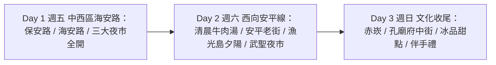

# 台南三天兩夜美食之旅完全攻略（週末版）

> **適用設定**：**週五～週日（週末出發）**｜台鐵／高鐵＋租機車或步行｜不忌口，同時附免大排長龍在地替代方案

---

## 目錄
1. [行前總覽與動線規劃](#行前總覽與動線規劃)
2. [週末關鍵工具：公休日與夜市對照表](#週末關鍵工具公休日與夜市對照表)
3. [Day 1（週五下午抵達）｜海安路中西區暖胃 × 三大夜市全開夜](#day-1週五下午抵達海安路中西區暖胃--三大夜市全開夜)
4. [Day 2（週六）｜清晨溫體牛 × 安平老街海風 × 武聖花園夜市](#day-2週六清晨溫體牛--安平老街海風--武聖花園夜市)
5. [Day 3（週日）｜早市傳統早點 × 孔廟赤崁散步 × 伴手禮賦歸](#day-3週日早市傳統早點--孔廟赤崁散步--伴手禮賦歸)
6. [免排隊在地替代名單 & 預算參考](#免排隊在地替代名單--預算參考)

---

## 行前總覽與動線規劃

台南市區巷弄密集且單行道多，**週末建議高鐵轉沙崙線至台南火車站＋站前租機車**，機動彈性最高。三天採「分區聚落」策略，每日點位騎車皆在 10～15 分鐘範圍內，不必跨城折返：

### 住宿區域建議
- **首選｜中西區（海安路、友愛街、西門圓環周邊）**：下樓就是小吃一級戰區，吃完宵夜步行即可回飯店，不用酒後騎車。
- **次選｜台南火車站前站／成功路一帶**：租還機車與寄放行李最方便，適合最後一天要搭車趕高鐵的行程。

### 台南吃貨 4 大心法
1. **每攤點 1 份分食**：兩人以上同行強烈建議共食，才能從早吃到宵夜塞下 6～8 攤。
2. **週末排隊要比平日更有耐心**：人氣名店假日排隊時間普遍拉長，部分名攤 11 點前就賣完。
3. **自備環保餐具與小零錢**：市場攤位多只收現金（百元鈔與銅板最好用），備好濕紙巾與保冷袋（買布丁／滷味用）。
4. **出發前滑一眼官方粉專**：台南老店偶有備料提早完售或臨時休假，建議出門前快速確認 Google Maps 或店家 FB／IG 最新公告。

---

## 週末關鍵工具：公休日與夜市對照表

### 1. 台南三大夜市週末完整對照（「大大武花大武花」）

| 星期 | 營業夜市 | 週末逛市重點 |
| :---: | :--- | :--- |
| **星期五** | 花園夜市、大東／大東東夜市、**武聖夜市** | **三大夜市同時開！** 建議先吃武聖（近中西區）再跳花園 |
| **星期六** | **花園夜市、武聖夜市** | 雙夜市齊開，人潮最旺；18:00 前到花園較容易找到位置 |
| **星期日** | **花園夜市** | 收假前的週末收心場，建議 19:00 前到才有完整攤數 |

### 2. 重點名店週末公休速查

| 店家名稱 | 所在區域 | 公休日 | 營業提醒 |
| :--- | :--- | :--- | :--- |
| **金得春捲** | 永樂市場 | **星期二** | 週末假日正常開，建議 11:00 前到避免完售 |
| **矮仔成蝦仁飯** | 海安路／西門 | **星期二** | 08:30～19:30 |
| **富盛號碗粿** | 永樂市場 | **星期四** | 週末正常開；民族路三段另有冷氣二店 |
| **阿松割包** | 永樂市場 | **星期四** | 週末正常開，主打豬舌包，有時不定期特休 |
| **六千泓佐土產牛肉** | 海安路一段 | **星期一、二、三** | 05:00 開賣，週六約 07:30 售完；週五因前一天備料，售完時間略晚 |
| **文章牛肉湯** | 安平區（安平路 592 號） | **星期四** | 週末正常開，10:30 至凌晨 02:00 |
| **阿憨鹹粥** | 北區公園南路 | **星期三** | 週末 06:10 開始，早到不用等 |
| **莉莉水果店** | 中西區府前路 | **星期三** | 週末 11:00～22:00 正常開 |
| **連得堂餅家** | 北區崇安街 | **星期日** | **週日公休！** 伴手禮需改至週五或週六購買 |
| **邱家小卷米粉** | 國華街三段 251 號 | **星期一**（偶含週三） | 週末正常開，有冷氣內用座位 |
| **阿明豬心冬粉** | 保安路 | **不定休（暫停營業中）** | 近期家務暫停，重開日期未定，出發前務必確認粉專 |

> **週末出發核心提醒**：
> - 連得堂餅家**週日公休**，煎餅伴手禮請在 **Day 1 週五** 或 **Day 2 週六** 提前購買。
> - 六千牛肉湯週六人潮最旺，強烈建議 **05:30 前到現場取號**（或乾脆週五晚上問店家隔天排號方式）。
> - 花園夜市週六人潮巨大，若不想被人群淹沒，**武聖夜市（週五、週六皆開）** 是在地人首選備案。

---

## Day 1（週五下午抵達）｜海安路中西區暖胃 × 三大夜市全開夜

| 時段 | 地點／店家 | 推薦必點 | 動線與備註 |
| :---: | :--- | :--- | :--- |
| **14:30** | 抵達台南火車站 → 租機車放行李 | — | 站前取車後先到飯店寄放行李，換上好走的鞋子 |
| **15:00** | **連得堂餅家**（崇安街巷內） | 雞蛋煎餅、味噌煎餅（通常每人限購 2 包） | **趁週五先買！週日公休**；從火車站騎車約 5 分鐘 |
| **16:00** | **正興街 × 蝸牛巷 × 蜷尾家** | 季節霜淇淋、蝸牛巷老屋拍照、正興咖啡 | 下午最熱時段安排室外散步，邊逛邊消食留胃給晚餐 |
| **17:30** | **保安路美食聚落** | **醇涎坊**（鍋燒意麵加蛋） **集品蝦仁飯**（蝦仁飯＋鴨蛋湯） **阿鳳浮水虱目魚羹** | 保安路整條老店林立；**阿明豬心**目前暫停，可改吃鄰近鱔魚意麵 |
| **19:30** | **三大夜市（週五全開！）選一主攻** | 武聖：炭烤、地瓜球、在地熟食 花園：紅妃香腸大腸、木瓜牛奶、各式台式小吃 大東：創意甜點、地方特色攤 | **建議策略**：先逛武聖（近市區、好停車）→ 若精力充沛再騎花園收尾；花園週五人比週六少 |
| **22:00** | **宵夜小收尾（選配）** | **一點刈包**（蛋餅＋豆漿）或 **民生路無名意麵** | 吃得下再加碼；神農街老屋酒吧小酌同樣是好選擇 |

---

## Day 2（週六）｜清晨溫體牛 × 安平老街海風 × 武聖花園夜市

| 時段 | 地點／店家 | 推薦必點 | 動線與備註 |
| :---: | :--- | :--- | :--- |
| **05:30** | **六千泓佐土產牛肉**（海安路一段） | 限量溫體牛肉湯（建議大碗）、肉燥飯 | 週六是全週最搶手場次，**05:30 前到**較安心；約 07:30 售完 |
| **08:00** | 回飯店補眠 | — | 喝完牛肉湯回去補個小睡是台南在地人精髓 |
| **10:00** | **永樂市場／國華街三段** | **富盛號**（碗粿＋魚羹） **金得春捲** **阿松割包**（豬舌包） | 三家毗鄰，建議分食各點一份；週六人潮大，10:00 前到比較不用等 |
| **12:00** | **邱家小卷米粉**（國華街三段 251 號）或 **葉家小卷米粉** | 小卷米粉、炸花枝丸 | 周六人多，備案直接走葉家同樣精彩 |
| **13:30** | **安平市場 → 安平老街** | **文章牛肉湯**（週六正常開，安平路 592 號） **同記安平豆花**（粉圓豆花） **周氏蝦捲** 或 **陳家蚵捲** | 文章牛肉湯今年剛搬新址；下午順遊安平樹屋與古堡 |
| **15:30** | **漁光島月牙灣** | 海邊散步、騎車繞島、林蔭步道拍照 | 離安平老街騎車 5 分鐘；待至 17:00 可看橘紅夕陽 |
| **18:00** | **返回市區吃晚餐墊胃** | **矮仔成蝦仁飯**（半熟鴨蛋一定要加） 或 **小杜意麵**（乾意麵＋骨肉湯） | 先吃鹹食墊胃，保留戰力給夜市 |
| **19:30** | **武聖夜市**（週六仍開）或 **花園夜市** | 武聖：陳家阿嬤拔絲地瓜、炭烤滷味、速立邁沙威瑪 花園：統大炭烤香雞排、二師兄古早味滷味 | 週六花園夜市人潮最頂峰，若嫌擁擠可選武聖（人潮較輕鬆）；兩場皆去的話建議先武聖後花園 |

---

## Day 3（週日）｜早市傳統早點 × 孔廟赤崁散步 × 伴手禮賦歸

> ⚠️ **注意**：連得堂餅家週日公休，伴手禮煎餅請在 Day 1（週五）已先購買。

| 時段 | 地點／店家 | 推薦必點 | 動線與備註 |
| :---: | :--- | :--- | :--- |
| **08:00** | **阿憨鹹粥**（北區公園南路） | 虱目魚肚粥＋油條（沾湯吃） | 週日正常開，06:10 起賣至 14:00；不吃鹹粥可改 **丹丹漢堡**（南台灣限定體驗） |
| **09:30** | **赤崁樓＆祀典武廟周邊** | **義豐阿川冬瓜茶**（冬瓜粉圓／冬瓜檸檬） 散步武廟紅牆、大天后宮 | 週日上午遊客相對集中赤崁樓，建議 09:30 前到趁早 |
| **11:00** | **孔廟商圈午餐** | **矮仔成蝦仁飯**（週日正常開） 或 **保哥黑輪**（炒泡麵） | 孔廟對面府中街文創小店與老屋咖啡可邊逛邊消食 |
| **13:00** | **冰品與水果站** | **莉莉水果店**（綜合水果切盤／豆花冰，週日正常開） 或 **太陽牌冰品**（紅豆牛奶霜＋草湖芋仔冰） | 午後最熱時段靠一碗冰品喚回體力 |
| **14:30** | **伴手禮大採購（最終站）** | **依蕾特布丁**（需冷藏）、**克林台包**（八寶肉包）、**安平蝦餅**（常溫）、**蜜餞零食**（赤崁周邊老店）、林百貨文創 | 連得堂週日休，若 Day 1 忘了買可在此改買其他伴手禮替代；布丁與肉包最後買並請附保冷劑 |
| **16:30** | **歸還機車 → 台南火車站 → 賦歸** | — | 預留 30～40 分鐘還車；若搭高鐵轉沙崙線建議 16:00 前出發 |

---

## 免排隊在地替代名單 & 預算參考

### 1. 週末不想等的聰明替代方案

| 原規劃熱門店 | 在地實力派替代方案 | 優勢與特色 |
| :--- | :--- | :--- |
| **六千牛肉湯**（清晨限量） | **文章牛肉湯**（安平路 592 號，全天供應至凌晨 2 點）或 **阿村牛肉湯**（保安路） | 文章牛肉湯假日不限量，可從容享用；湯頭濃郁偏台式 |
| **富盛號／阿松割包**（人龍嚇人） | **水仙宮米糕**（鄰近永樂市場）或 **好味紅燒土魠魚羹** | 在地人平日常吃、週末排隊相對快速 |
| **蜷尾家霜淇淋**（排隊長） | **竹記冬瓜茶**、**太陽牌冰品**、**波哥茶飲** | 台南人日常更常喝的老字號飲品，無需排隊 |
| **連得堂煎餅**（週日休） | **舊永瑞珍餅舖**（傳統大餅）或 **合進製麵**、**益生堂蜜餞** | 伴手禮選擇多元，不受公休限制 |

### 2. 三天兩夜參考預算（單人，不含高鐵／台鐵車票）

| 項目 | 精打細算小吃派 | 舒適小酌加碼派 |
| :--- | :---: | :---: |
| **住宿（週末 2 晚）** | NT$ 2,200 ～ 3,500（週末加價） | NT$ 4,500 ～ 7,000（設計旅店／老屋民宿） |
| **租機車＋油資（3 天）** | NT$ 900 ～ 1,200 | NT$ 1,200 ～ 1,500 |
| **三餐＋夜市＋點心** | NT$ 2,000 ～ 3,000 | NT$ 3,500 ～ 5,000（含宵夜酒吧） |
| **伴手禮＋門票** | NT$ 800 ～ 1,500 | NT$ 1,500 ～ 2,500 |
| **合計（不含長途車票）** | **約 NT$ 5,900 ～ 9,200** | **約 NT$ 10,700 ～ 16,000** |

> **平日 vs. 週末出發建議**：若可請假，請優先考慮平日（週三～週五）版行程（詳見 [travel.md](./travel.md)），店家等候時間大幅縮短、夜市空間更舒適，整體體驗會更好。
