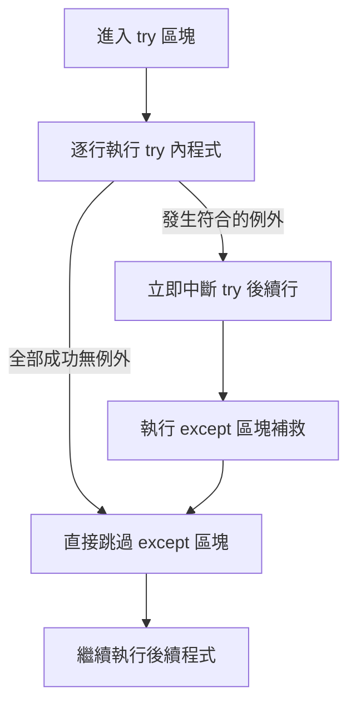
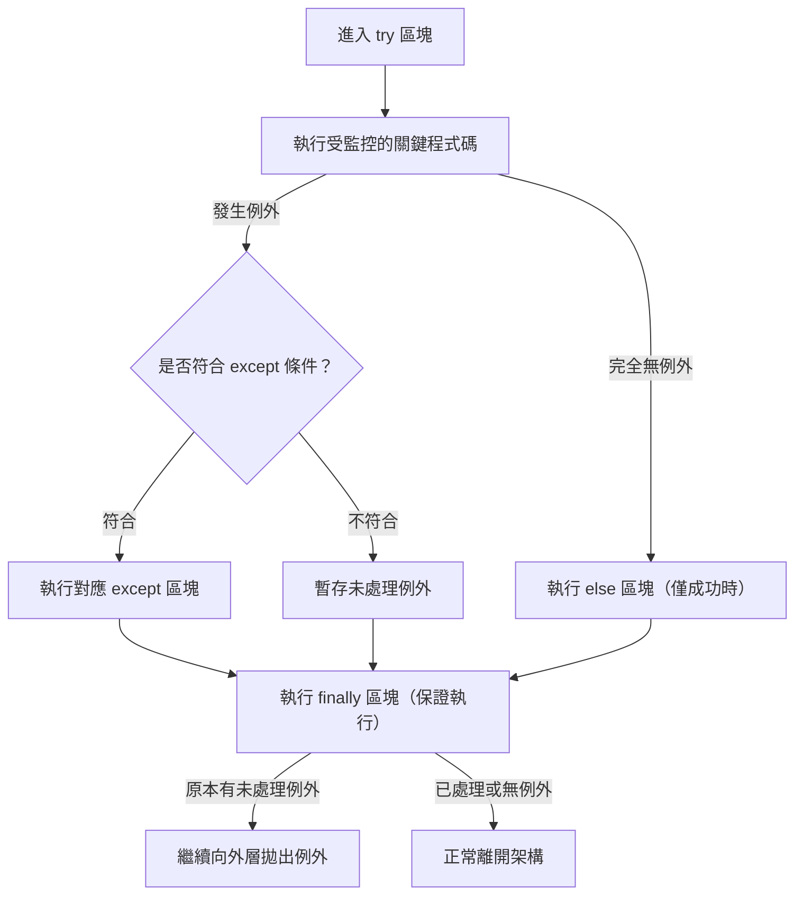
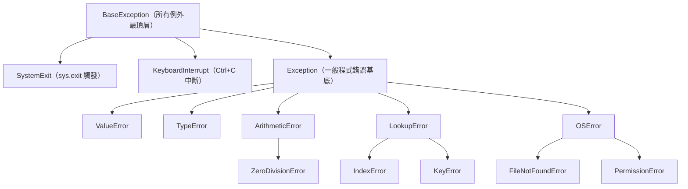

# Python `try ~ except` 例外處理完全指南：由淺入深

本講義專為 Python 課堂教學設計，依照**「認識錯誤 → 精準捕捉 → 完整控制流 → 實戰設計 → 進階架構」**五個階段循序推進，並結合本目錄的 [calc.py](./calc.py) 範例，協助學習者從「程式不再意外崩潰」進階到「寫出可維護、好除錯的例外處理架構」。

---

## 課程地圖


### 目錄
1. [第一階｜入門暖身：為什麼程式會「當掉」？](#第一階入門暖身為什麼程式會當掉)
2. [第二階｜核心精準捕捉：指定例外與多分支處理](#第二階核心精準捕捉指定例外與多分支處理)
3. [第三階｜完整控制流：`try ... except ... else ... finally`](#第三階完整控制流try--except--else--finally)
4. [第四階｜實戰與設計思維：主動拋出與專案實例串接](#第四階實戰與設計思維主動拋出與專案實例串接)
5. [第五階｜進階架構與現代 Python 技巧](#第五階進階架構與現代-python-技巧)
6. [第六階｜課堂分級實戰練習](#第六階課堂分級實戰練習)
7. [常見內建例外速查表](#常見內建例外速查表)

---

## 第一階｜入門暖身：為什麼程式會「當掉」？

### 1.1 語法錯誤 (`SyntaxError`) vs. 執行期例外 (`Exception`)

初學程式時常把「紅字報錯」混為一談，其實 Python 的錯誤分成兩種截然不同的階段：

| 類型 | 發生時機 | 能否用 `try ... except` 攔截 | 常見例子 |
| :--- | :--- | :--- | :--- |
| **語法錯誤 (`SyntaxError`)** | 程式碼**執行前**（解析階段） | **不能**（連啟動都失敗） | 漏掉冒號 `:`、括號未成對、縮排混亂 |
| **例外 (`Exception`)** | 程式碼**執行期間**（Runtime） | **可以**（可預期並優雅恢復） | `10 / 0`、`int("abc")`、讀取不存在的檔案 |

```python
# 1. 語法錯誤：在執行前就會失敗，try-except 救不到
# if True
#     print("少了冒號")  # -> SyntaxError

# 2. 執行期例外：語法完全合法，但執行當下遇到問題
number = int("hello")  # -> ValueError: invalid literal for int() with base 10: 'hello'
```

### 1.2 如何看懂 Traceback（錯誤回溯訊息）

當例外沒有被處理時，Python 會印出 Traceback 並中斷程式。閱讀口訣是**「由下往上看」**：

```text
Traceback (most recent call last):
  File "demo.py", line 5, in <module>
    main()                                  <-- 3. 最外層呼叫點
  File "demo.py", line 2, in main
    return int("abc")                       <-- 2. 實際出錯的那一行
ValueError: invalid literal for int() ...   <-- 1. 先看這裡：錯誤類型與原因
```

1. **先看最後一行**：得知例外名稱（`ValueError`）與錯誤說明。
2. **往上看最後一個檔案與行號**：找出直接引發錯誤的位置。
3. **再往上看呼叫鏈**：釐清是誰把錯誤資料傳進來的。

### 1.3 最小可用的 `try ... except`



```python
def safe_to_int(text: str) -> int | None:
    """嘗試將字串轉為整數，失敗時回傳 None 而不中斷程式。"""
    try:
        value = int(text)
        print(f"轉換成功：{value}")
        return value
    except ValueError:
        print(f"【提示】'{text}' 不是有效的整數格式")
        return None


print(safe_to_int("42"))
print(safe_to_int("abc"))
print("程式依然正常走到最後一行！")
```

#### 執行結果
```text
轉換成功：42
42
【提示】'abc' 不是有效的整數格式
None
程式依然正常走到最後一行！
```

---

## 第二階｜核心精準捕捉：指定例外與多分支處理

### 2.1 為什麼強烈反對裸 `except:`？

剛學 `try ... except` 時，有些人會寫成不指定類型的裸 `except:`：

```python
# 反面教材：不要這樣寫！
try:
    user_input = input("請輸入數字：")
    result = 100 / int(user_input)
except:
    print("發生錯誤了！")
```

這會帶來兩個嚴重問題：
1. **遮蔽真正的 Bug**：不管是 `ZeroDivisionError`、`ValueError`，甚至變數拼錯引發的 `NameError`，全部都會變成同一句「發生錯誤了！」，完全無法除錯。
2. **連系統中斷都攔截**：使用者按下 `Ctrl + C` 觸發的 `KeyboardInterrupt` 也會被吃掉，導致程式按不掉、關不死。

> **黃金原則**：永遠明確指定你想處理的例外類型。

### 2.2 取得例外物件細節 (`as e`)

透過 `as e`，我們能把捕捉到的例外實例存成變數，印出類型名稱與原始訊息，方便除錯與寫入日誌：

```python
def parse_positive_int(raw: str) -> int | None:
    try:
        num = int(raw)
        return 100 // num
    except ValueError as e:
        print(f"[輸入格式錯誤] 類型={type(e).__name__}, 訊息={e}")
        return None
    except ZeroDivisionError as e:
        print(f"[數學運算錯誤] 類型={type(e).__name__}, 訊息={e}")
        return None


parse_positive_int("xyz")
parse_positive_int("0")
```

### 2.3 多重 `except` 分支與「順序原則」

當單一 `try` 區塊可能產生多種不同錯誤時，可以用多個 `except` 分門別類處理，或用 tuple 合併相同處理邏輯的例外：

```python
def get_item_ratio(items: list[int], index: int) -> float | None:
    try:
        target = items[index]
        return 100 / target
    except (IndexError, TypeError) as e:
        # 兩種錯誤都屬於「索引或資料結構存取問題」，合併處理
        print(f"無法取得有效元素：{type(e).__name__} ({e})")
        return None
    except ZeroDivisionError:
        print("目標元素不可為 0")
        return None
```

#### ⚠️ 關鍵陷阱：子類別必須放在父類別前面！

Python 會**由上而下**比對 `except`，命中第一個符合的就會停止。若把父類別放在前面，後面的子類別永遠不會被執行：

```python
# ❌ 錯誤順序：OSError 是 FileNotFoundError 的父類別
try:
    with open("missing.txt", encoding="utf-8") as f:
        print(f.read())
except OSError:
    print("一般作業系統錯誤")       # 永遠先被這行攔走！
except FileNotFoundError:
    print("找不到檔案")             # 永遠不會執行到這裡

# ✅ 正確順序：具體子類別在前，廣泛父類別在後
try:
    with open("missing.txt", encoding="utf-8") as f:
        print(f.read())
except FileNotFoundError:
    print("找不到檔案，請確認路徑")
except OSError as e:
    print(f"其他檔案系統錯誤：{e}")
```

---

## 第三階｜完整控制流：`try ... except ... else ... finally`

Python 提供四個關鍵字組成完整的例外處理生命週期：



### 3.1 四個區塊的職責分工

| 關鍵字 | 何時執行 | 應該放什麼程式碼 |
| :--- | :--- | :--- |
| **`try`** | 每次進入都會執行 | **只放最可能出錯的幾行**（縮小受保護範圍） |
| **`except`** | 發生指定例外時 | 錯誤恢復、提示訊息、日誌記錄或轉拋例外 |
| **`else`** | **`try` 完全沒出錯**時 | 依賴 `try` 成功結果的後續邏輯（避免誤抓其他例外） |
| **`finally`** | **無論成功、失敗、甚至 `return` 或未捕捉例外前** | 釋放資源（關閉連線、清理暫存檔、釋放鎖定） |

### 3.2 為什麼需要 `else`？（初學者最常忽略的細節）

比較以下兩種寫法，假設 `int(raw)` 是我們想監控的輸入轉換，而 `process(num)` 內部也可能因 Bug 拋出 `ValueError`：

```python
# ❌ 不好的寫法：把後續處理也塞進 try
try:
    num = int(raw)
    result = process(num)  # 萬一這裡拋出 ValueError，會被誤判為「輸入格式錯誤」
except ValueError:
    print("輸入不是數字！")

# ✅ 好的寫法：利用 else 縮小 try 範圍
try:
    num = int(raw)         # 只保護真正要驗證輸入的那一行
except ValueError:
    print("輸入不是數字！")
else:
    result = process(num)  # 這裡若出錯會正常暴露，不會被錯誤標籤掩蓋
```

### 3.3 完整四區塊示範與 `finally` 的實際行為

```python
def load_and_double(raw: str) -> int | None:
    print(f"\n--- 處理輸入: {raw!r} ---")
    try:
        value = int(raw)
    except ValueError:
        print("[except] 格式不合法，無法轉為整數")
        return None
    else:
        doubled = value * 2
        print(f"[else] 轉換成功，兩倍結果為 {doubled}")
        return doubled
    finally:
        # 即使上面已經走到 return，finally 仍會在真正離開函式前執行！
        print("[finally] 清理流程執行完畢")


load_and_double("15")
load_and_double("oops")
```

#### 執行結果
```text
--- 處理輸入: '15' ---
[else] 轉換成功，兩倍結果為 30
[finally] 清理流程執行完畢

--- 處理輸入: 'oops' ---
[except] 格式不合法，無法轉為整數
[finally] 清理流程執行完畢
```

> **實務補充**：如果是檔案或網路連線等資源清理，優先使用 `with open(...) as f:`（Context Manager），因為它底層已自動幫你實作了等價於 `try ... finally: f.close()` 的機制，寫法更簡潔。

---

## 第四階｜實戰與設計思維：主動拋出與專案實例串接

### 4.1 分層責任：底層 `raise`，上層 `try ... except`

在實際專案開發中，**不是每個函式都要自己寫 `try ... except`**！
以本目錄既有的 [calc.py](./calc.py) 為例：

```python
# 2026_11_25/calc.py
def divide(a: int | float, b: int | float) -> float:
    """回傳 a 除以 b 的結果；當 b 為 0 時拋出 ValueError。"""
    if b == 0:
        raise ValueError("除數不可為零")
    return a / b
```

為什麼 `divide()` 不自己 `print("錯誤")` 並回傳 `None`，而是選擇 `raise ValueError("除數不可為零")`？
- **單一職責**：商業邏輯函式不知道呼叫者是 CLI、Web API 還是批次腳本，不應該擅自 `print` 或吞掉錯誤。
- **明確契約**：透過 `raise` 通知呼叫端「前提條件不成立」，且能配合單元測試（如 [tests/test_calc.py](./tests/test_calc.py) 的 `assertRaises(ValueError)`）精準驗證。
- **呼叫端決定應對方式**：互動程式可以提示重輸，API 可以回傳 HTTP 400。

```python
from calc import divide


def interactive_divide(a_str: str, b_str: str) -> None:
    """呼叫端（UI 層）負責捕捉並轉換為友善提示。"""
    try:
        a = float(a_str)
        b = float(b_str)
        ans = divide(a, b)
    except ValueError as e:
        # 無論是 float() 轉型失敗，還是 divide() 主動拋出的 "除數不可為零"，皆屬輸入無效
        print(f"計算失敗：{e}")
    else:
        print(f"計算結果：{a} / {b} = {ans}")


interactive_divide("10", "2")     # 計算結果：10.0 / 2.0 = 5.0
interactive_divide("10", "0")     # 計算失敗：除數不可為零
interactive_divide("abc", "2")    # 計算失敗：could not convert string to float: 'abc'
```

### 4.2 重新拋出 (`raise`) 與例外鏈 (`raise ... from ...`)

1. **僅記錄後原封不動往上拋（Re-raise）**：
   在 `except` 區塊內使用單獨一個 `raise`，保留原始例外類型與完整 Traceback。
2. **轉換為高階語意例外（Exception Chaining）**：
   使用 `raise NewError(...) from original_err`，讓上層看到高階錯誤訊息的同時，開發者仍可從 Traceback 追查底層根因；若刻意要隱藏底層細節，才使用 `from None`。

```python
class ConfigLoadError(Exception):
    """設定檔載入失敗的高階業務例外。"""


def read_port(path: str) -> int:
    try:
        with open(path, encoding="utf-8") as f:
            return int(f.read().strip())
    except FileNotFoundError as err:
        # 保留原始 FileNotFoundError 作為 __cause__，便於工程師除錯
        raise ConfigLoadError(f"找不到設定檔：{path}") from err
    except ValueError as err:
        raise ConfigLoadError(f"設定檔 {path} 內容必須為整數埠號") from err
```

### 4.3 設計哲學：EAFP vs. LBYL

| 比較面向 | **LBYL (Look Before You Leap)**<br>三思而後行 | **EAFP (Easier to Ask for Forgiveness than Permission)**<br>先做再說，出錯再補救 |
| :--- | :--- | :--- |
| **寫法特徵** | 事前大量 `if` 檢查 | 直接操作並用 `try ... except` 處理例外 |
| **Python 範例** | `if key in data: val = data[key]` | `try: val = data[key] except KeyError: ...` |
| **優點** | 條件單純時直觀易讀 | 避免 **TOCTOU 競態條件**（檢查完瞬間檔案被刪）、熱路徑效能更佳 |
| **建議情境** | 簡單的數值邊界判斷（如 `if b == 0:`） | 檔案 I/O、字典/屬性存取、網路請求、字串轉型 |

---

## 第五階｜進階架構與現代 Python 技巧

### 5.1 內建例外繼承階層

理解繼承樹，就能徹底明白為什麼應該寫 `except Exception:` 而不是 `except BaseException:` 或裸 `except:`：



- 程式中若需要一個「兜底記錄」的層級，最高只應攔截 **`Exception`**，絕對不要攔截 `BaseException`。

### 5.2 自訂例外類別（附帶結構化資訊）

當專案規模擴大時，建立專屬的例外階層能讓錯誤處理更清晰，也能攜帶除錯所需的欄位：

```python
class AppError(Exception):
    """專案基礎例外類別，方便呼叫端統一捕捉整個模組的業務錯誤。"""


class InsufficientBalanceError(AppError):
    """帳戶餘額不足時拋出。"""

    def __init__(self, current_balance: int, required_amount: int) -> None:
        self.current_balance = current_balance
        self.required_amount = required_amount
        shortage = required_amount - current_balance
        super().__init__(
            f"餘額不足：目前餘額 {current_balance} 元，欲扣款 {required_amount} 元（尚差 {shortage} 元）"
        )


def pay(balance: int, amount: int) -> int:
    if amount <= 0:
        raise ValueError("扣款金額必須大於 0")
    if amount > balance:
        raise InsufficientBalanceError(balance, amount)
    return balance - amount


try:
    pay(500, 800)
except InsufficientBalanceError as e:
    print(f"交易失敗：{e}")
    print(f"差額明細：{e.required_amount - e.current_balance} 元")
```

### 5.3 必須避開的四大反模式 (Anti-Patterns)

1. **Silent Failure（靜默吞掉錯誤）**
   ```python
   # ❌ 極度危險：出錯了完全沒人知道
   try:
       save_to_database(record)
   except Exception:
       pass
   ```
   至少要記錄日誌（如 `logging.exception(...)`）或明確標記為何可安全忽略。

2. **在 `finally` 中使用 `return` / `break` / `continue`**
   ```python
   # ❌ 會把 try 裡面發生的 ZeroDivisionError 完全吃掉，最後竟然正常回傳 0！
   def tricky() -> int:
       try:
           return 1 // 0
       finally:
           return 0
   ```

3. **`try` 區塊過於龐大**
   把上百行函式全包在一個 `try` 裡，發生 `KeyError` 或 `ValueError` 時根本分不清是哪一步出錯。

4. **把例外當成一般流程控制（濫用效能與可讀性）**
   正常的迴圈終止或單純條件分支應使用 `if` / `for`，只在「異常或邊界情況」使用 `try ... except`。

### 5.4 Python 3.11+ 現代語法：`ExceptionGroup` 與 `except*`

在非同步任務（`asyncio`）或批次處理多筆資料時，可能同時發生**好幾個不同類型的例外**。Python 3.11 起引入了 `ExceptionGroup` 與 `except*` 語法，可以分別針對群組內的特定例外類型做拆解處理：

```python
def run_batch() -> None:
    errors: list[Exception] = [
        ValueError("第 2 筆格式錯誤"),
        KeyError("missing_id"),
        ValueError("第 5 筆數值為負"),
    ]
    raise ExceptionGroup("批次作業部分失敗", errors)


try:
    run_batch()
except* ValueError as eg:
    print(f"共捕捉到 {len(eg.exceptions)} 個數值錯誤：")
    for err in eg.exceptions:
        print(f"  - {err}")
except* KeyError as eg:
    print(f"共捕捉到 {len(eg.exceptions)} 個缺鍵錯誤：")
    for err in eg.exceptions:
        print(f"  - {err}")
```

#### 執行結果
```text
共捕捉到 2 個數值錯誤：
  - 第 2 筆格式錯誤
  - 第 5 筆數值為負
共捕捉到 1 個缺鍵錯誤：
  - 'missing_id'
```

> **提示**：一般情況下 `except` 一次只會進入一個分支；而 `except*` 會把群組內符合的例外逐一拆出來處理，因此多個 `except*` 分支**可能會同時被執行**。

---

## 第六階｜課堂分級實戰練習

### 練習 1（初階）：安全平均值計算
- **題目**：撰寫 `safe_average(numbers: list[float]) -> float | None`，計算串列平均值；若串列為空導致 `ZeroDivisionError`，印出提示並回傳 `None`。

<details>
<summary>點擊查看參考解答</summary>

```python
def safe_average(numbers: list[float]) -> float | None:
    try:
        return sum(numbers) / len(numbers)
    except ZeroDivisionError:
        print("串列為空，無法計算平均值")
        return None
```

</details>

### 練習 2（中階）：串接 `calc.divide` 的批次計算器
- **題目**：輸入一組 `(a_str, b_str)` 配對，例如 `[("10", "2"), ("8", "0"), ("bad", "3")]`，使用 `calc.divide` 計算商數。請區分「字串轉數字失敗」與「除數為零」，並確保每筆處理結束都印出 `"--- 本筆結束 ---"`。

<details>
<summary>點擊查看參考解答</summary>

```python
from calc import divide


def batch_divide(pairs: list[tuple[str, str]]) -> None:
    for a_str, b_str in pairs:
        try:
            a = float(a_str)
            b = float(b_str)
        except ValueError:
            print(f"格式錯誤：({a_str!r}, {b_str!r}) 無法轉為數字")
        else:
            try:
                result = divide(a, b)
            except ValueError as e:
                print(f"運算規則錯誤：{e}")
            else:
                print(f"{a} / {b} = {result}")
        finally:
            print("--- 本筆結束 ---")
```

</details>

### 練習 3（進階）：自訂例外與例外鏈
- **題目**：建立自訂例外 `DataPipelineError`，撰寫 `load_first_ratio(path: str) -> float`：讀取檔案第一行的兩個以逗號分隔的數字並呼叫 `calc.divide(a, b)`。若發生 `FileNotFoundError` 或 `ValueError`，請統一包裝成 `DataPipelineError` 並使用 `raise ... from ...` 保留原始原因。

<details>
<summary>點擊查看參考解答</summary>

```python
from calc import divide


class DataPipelineError(Exception):
    """資料管線處理失敗例外。"""


def load_first_ratio(path: str) -> float:
    try:
        with open(path, encoding="utf-8") as f:
            first_line = f.readline().strip()
        left, right = first_line.split(",")
        return divide(float(left), float(right))
    except (FileNotFoundError, ValueError) as err:
        raise DataPipelineError(f"處理檔案 {path!r} 失敗：{err}") from err
```

</details>

---

## 常見內建例外速查表

| 例外類別 | 繼承父類 | 常見觸發情境 | 快速範例 |
| :--- | :--- | :--- | :--- |
| **`ZeroDivisionError`** | `ArithmeticError` | 除數為 `0` | `10 / 0` |
| **`ValueError`** | `Exception` | 型別正確但數值/格式不合法 | `int("abc")`、`divide(1, 0)` |
| **`TypeError`** | `Exception` | 型別不相容的操作 | `"10" + 5` |
| **`IndexError`** | `LookupError` | 序列索引超出範圍 | `[1, 2][3]` |
| **`KeyError`** | `LookupError` | 字典中找不到指定鍵 | `{"a": 1}["b"]` |
| **`FileNotFoundError`** | `OSError` | 檔案或路徑不存在 | `open("none.txt")` |
| **`AttributeError`** | `Exception` | 存取不存在的物件屬性或方法 | `(123).strip()` |
| **`KeyboardInterrupt`** | `BaseException` | 使用者按下 `Ctrl + C` | 終端機中斷程式 |
